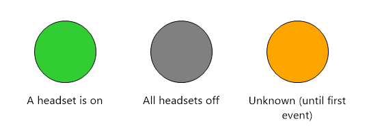
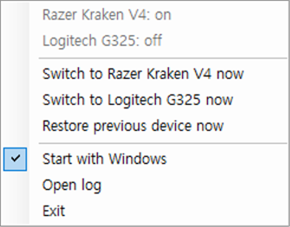
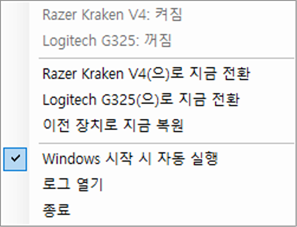

# Headset Auto Switch — Razer Kraken V4 · Logitech G325

**한국어 | English** (병기 / bilingual) · [⬇ Download / 다운로드](https://github.com/TresureStrong-Gold/headset-auto-switch/releases/latest)

> **Auto audio output switch for wireless headsets on Windows — Razer Kraken V4 and Logitech G325 LIGHTSPEED.**
> Turn the headset on → Windows output switches to the headset. Turn it off → it switches back to your speakers. The USB dongle can stay plugged in.
>
> **무선 헤드셋(Razer Kraken V4, Logitech G325) 전원 on/off에 맞춰 Windows 출력 장치를 자동 전환합니다.**
> 헤드폰을 켜면 헤드셋으로, 끄면 다시 스피커로. 동글은 계속 꽂아 둬도 됩니다.



## 지원 헤드셋 / Supported headsets

| 헤드셋 / Headset | 동글 / Dongle (VID:PID) | 감지 방식 / Detection |
|---|---|---|
| Razer Kraken V4 (wireless) | `1532:056C` | 동글이 보내는 전원 이벤트 / power event sent by the dongle |
| Logitech G325 LIGHTSPEED | `046D:0B21` | 2초마다 헤드셋에 질의 / polls the headset every ~2 s |

두 동글을 함께 꽂아 써도 됩니다. 여러 헤드셋이 켜져 있으면 **가장 최근에 켠 헤드셋**으로, 모두 꺼지면 원래 장치로 돌아갑니다.
Both dongles can be plugged in at once. With several headsets on, the **most recently turned-on** one wins; when all are off, the original device is restored.

## 이런 분께 / Who is this for

- 동글을 상시 꽂아 두고 헤드폰만 켜고 끄는데, 끌 때마다 **소리가 안 나와서** 출력 장치를 수동으로 바꾸시는 분
  You keep the dongle plugged in, and every time you power the headset off the sound goes nowhere until you switch the output device by hand.
- "Razer Kraken V4 auto switch audio output", "Logitech G325 switch output automatically", "dongle always connected", "headset power off no sound" 로 검색해 오신 분
  You searched for *Razer Kraken V4 / Logitech G325 auto switch audio output*, *dongle always connected*, or *headset off no sound*.

Windows 는 동글의 오디오 장치를 헤드폰이 꺼져도 계속 "연결됨"으로 보기 때문에 기본 기능으로는 자동 전환이 되지 않습니다.
Windows keeps the dongle's audio devices "connected" even when the headset is off, so there is no built-in way to auto-switch.

| 헤드폰 / Headset | 동작 / Action |
|---|---|
| ON  | 재생·통신 장치 → 헤드셋 (Kraken: `Game` / `Chat`), 직전 기본 장치는 저장<br>Playback & communications → the headset (Kraken: `Game` / `Chat`); previous defaults are remembered |
| OFF | 저장해 둔 직전 장치(스피커, 모니터 등)로 복원<br>Restores the previously remembered devices (speakers, monitor, etc.) |

## 설치 / Install

### 방법 1: 내려받아 실행 / Option 1: Download
1. [Releases](https://github.com/TresureStrong-Gold/headset-auto-switch/releases/latest) 에서 `KrakenAutoSwitch.exe` 다운로드 (이름은 v1 호환을 위해 유지)
   Download `KrakenAutoSwitch.exe` from [Releases](https://github.com/TresureStrong-Gold/headset-auto-switch/releases/latest) (file name kept for v1 compatibility).
2. 고정 폴더(예: `%LOCALAPPDATA%\KrakenAutoSwitch`)에 넣고 실행. 설정·로그 파일이 같은 폴더에 생성됩니다.
   Put it in a permanent folder (e.g. `%LOCALAPPDATA%\KrakenAutoSwitch`) and run it. Settings and log files are created next to it.
3. 트레이 아이콘 우클릭 → "Start with Windows"(한국어 Windows 에서는 "Windows 시작 시 자동 실행") 체크
   Right-click the tray icon and enable "Start with Windows".

Razer Synapse 나 Logitech G HUB 는 필요 없으며, 함께 실행돼 있어도 됩니다.
Razer Synapse / Logitech G HUB are not required, and can run alongside.

> ⚠️ **SmartScreen 경고 / SmartScreen warning**
> 코드 서명이 없는 개인 프로젝트라 "Windows의 PC 보호" 경고가 뜰 수 있습니다. "추가 정보 → 실행"을 누르세요. 못 미더우면 아래 방법 2로 소스에서 직접 빌드할 수 있고, Releases 의 SHA-256 으로 파일을 검증할 수 있습니다.
> This is an unsigned hobby project, so Windows may show a "Windows protected your PC" prompt. Click "More info → Run anyway". If you'd rather not trust a binary, build it yourself (Option 2) or verify the SHA-256 listed on the release.

### 방법 2: 직접 빌드 / Option 2: Build from source
`build.bat` 실행 (Windows 기본 .NET Framework 컴파일러만 사용, 별도 설치 불필요).
Run `build.bat` (uses only the .NET Framework compiler that ships with Windows; nothing to install).

## 사용법 / Usage

English UI (default) / 한국어 UI (Windows 표시 언어가 한국어면 자동):

 

- 꽂혀 있는 동글의 헤드셋만 메뉴에 표시됩니다. / Only headsets whose dongle is plugged in are listed.
- 아이콘 색: 초록=헤드셋 켜짐, 회색=모두 꺼짐, 주황=아직 모름(Kraken 은 첫 on/off 이벤트 전까지)
  Icon colors: green = a headset is on, gray = all off, orange = not known yet (Kraken: until its first on/off event).
- 메뉴에서 수동 전환, 자동 실행 토글, 로그 보기를 할 수 있습니다.
  The menu offers manual switching, a start-with-Windows toggle and the log.

첫 실행 시 `KrakenAutoSwitch.ini`가 생성됩니다. / A `KrakenAutoSwitch.ini` is created on first run.

```ini
; Device names are substring matches / 장치 이름은 '포함' 일치
kraken.game=Razer Kraken V4 - Game
kraken.chat=Razer Kraken V4 - Chat
g325.game=G325 LIGHTSPEED
g325.chat=G325 LIGHTSPEED
; Device to restore if nothing was remembered / 저장된 장치가 없을 때 복원할 장치
fallback=
; UI language: auto (follow Windows) | en | ko
language=auto
```

Windows 언어와 관계없이, 장치 이름이 위 값을 포함하면 동작합니다. v1 의 `game=` / `chat=` 키도 Kraken 설정으로 그대로 읽습니다.
Works on any Windows language as long as the device name contains the values above. v1's `game=` / `chat=` keys are still read as the Kraken settings.

## 원리 / How it works

헤드폰이 꺼져도 동글의 오디오 장치는 계속 활성 상태라, 동글의 벤더 HID 인터페이스로 헤드셋 상태를 알아냅니다.
Even with the headset off, the dongle's audio endpoints stay active, so the headset state is read from the dongle's vendor HID interface.

**Razer Kraken V4** — Usage Page `0xFF14` 로 전원 이벤트가 옵니다. / The dongle pushes a power event on Usage Page `0xFF14`:

```
02 0A 60 .. .. .. 05 00 80 80 20 02 01 <state>      state: 01 = on, 00 = off
```

**Logitech G325** — 동글이 전원 변화를 알려주지 않아서, Logitech "Centurion" 프로토콜(Usage Page `0xFFA0`, 리포트 ID `0x50`)로 2초마다 헤드셋에 질의합니다. 응답이 오면 켜짐, 두 번 연속 응답이 없으면 꺼짐입니다.
The dongle does not announce power changes, so the app polls the headset every ~2 s over Logitech's "Centurion" protocol (Usage Page `0xFFA0`, report ID `0x50`). A reply means on; two missed replies mean off.

```
find address : 50 <addr> 06 00  00 1A 00 00 00            ROOT.GetProtocolVersion, scanned until the dongle answers (G325: 0x23)
bridge index : 50 23 05 00      00 0A 00 03               ROOT.GetFeature(0x0003 CentPPBridge) -> 3
poll headset : 50 23 0A 00      03 1B 00 05 00 00 0B 00 01 bridge -> headset ROOT.GetFeature(0x0001)
```

프레임 구조는 [Solaar](https://github.com/pwr-Solaar/Solaar)의 Centurion 지원(PRO X 2 / G522)을 참고했습니다. 모두 읽기 전용 조회이며 헤드셋 설정은 바꾸지 않습니다.
The framing follows [Solaar](https://github.com/pwr-Solaar/Solaar)'s Centurion support (PRO X 2 / G522). All requests are read-only queries; no headset settings are changed.

오디오 전환은 Core Audio + `IPolicyConfigVista`(비공개 COM 인터페이스, SoundSwitch 등 다수 도구가 사용)로 합니다. HID 는 공유 모드로 열어 Synapse / G HUB 와 함께 쓸 수 있습니다.
Switching uses Core Audio plus `IPolicyConfigVista` (an undocumented COM interface also used by tools such as SoundSwitch). HID is opened in shared mode, so it coexists with Synapse / G HUB.

## 한계 / Limitations

- Kraken V4 는 프로그램 시작 시점의 상태를 알 수 없고, 다음 on/off 이벤트부터 맞춰집니다 (트레이 메뉴에서 수동 전환 가능). G325 는 시작 직후 바로 상태를 압니다.
  For the Kraken V4 the state at app start is unknown until the next on/off event (manual switch is available from the tray menu). The G325 state is known right away.
- Windows 11 에서 Kraken V4 + 동글(PID `056C`), G325 + 동글(PID `0B21`)로 확인했습니다.
  Tested on Windows 11 with the Kraken V4 + dongle (PID `056C`) and the G325 + dongle (PID `0B21`).
- 비공식 프로젝트이며 Razer, Logitech 와 무관합니다. / Unofficial project, not affiliated with Razer or Logitech.

## 다른 헤드셋 지원에 참여하기 / Help support other headsets

상시 연결 동글 + 전원 on/off 구조의 다른 모델도 같은 방식으로 지원할 수 있을 가능성이 큽니다.
Other dongle-based headsets likely work the same way.

1. `build.bat` 으로 `HidDiag.exe` 빌드 (또는 Releases 에서 다운로드). 본인 동글의 VID/PID 를 인자로 줘서 실행합니다: `HidDiag.exe "vid_xxxx&pid_xxxx"` (장치 관리자 → 동글 → 속성 → 하드웨어 ID). 인자를 생략하면 Kraken V4 값이 사용됩니다.
   Build `HidDiag.exe` and pass your dongle's VID/PID as an argument: `HidDiag.exe "vid_xxxx&pid_xxxx"` (Device Manager → dongle → Properties → Hardware IDs). Defaults to the Kraken V4.
2. `HidDiag.exe` 를 실행한 채 헤드폰을 끄고 켜 보세요. 전원을 바꿀 때만 나오는 리포트가 이벤트입니다. 아무것도 안 나오면 G325 처럼 질의가 필요한 모델입니다 (로지텍 신형은 Usage Page `0xFFA0` 이 보이면 Centurion 일 가능성이 큽니다).
   Run `HidDiag.exe` and power the headset off/on. The report that appears only on power changes is the event. If nothing shows up, the model needs polling like the G325 (newer Logitech headsets with Usage Page `0xFFA0` are likely Centurion).
3. 결과를 [Issue (Headset model report)](https://github.com/TresureStrong-Gold/headset-auto-switch/issues/new?template=model-report.md) 로 알려 주세요. 모델명, VID/PID, on/off 때의 리포트 바이트를 적어 주시면 지원을 추가하겠습니다. PR 도 환영합니다.
   Report it via an [issue (Headset model report)](https://github.com/TresureStrong-Gold/headset-auto-switch/issues/new?template=model-report.md) with the model, VID/PID and the report bytes for on and off. PRs welcome.

## License

MIT
